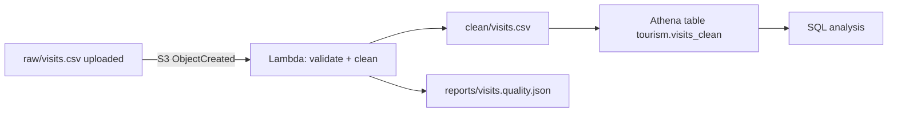

# AWS Tourism Data Pipeline

A small serverless data-quality pipeline. A raw CSV of tourism visits is uploaded to **S3**, a **Lambda** function validates and cleans it, and the cleaned file is queried with **Athena** (SQL on S3). Every run also writes a quality report that says how many rows were rejected and why.

> **About the data:** the sample file is **synthetic** (generated by `src/generate_sample_data.py`), with about 8% of rows corrupted on purpose. It is inspired by the tourism analytics project I did during my Labmentix internship, but it is not real traveller data.

## Architecture



## Validation rules

Each rejected row is counted under one reason, checked in this order.

| # | Reason | Rule |
|---|---|---|
| 1 | `missing_required_value` | Any required column is null or blank |
| 2 | `duplicate_visit_id` | `visit_id` already seen (first occurrence is kept) |
| 3 | `invalid_rating` | Rating is not a whole number from 1 to 5 |
| 4 | `invalid_month` | `visit_month` is not 1 to 12 |
| 5 | `invalid_visit_mode` | Not one of Business, Couples, Family, Friends, Solo |

## Example result (local run on 5,000 synthetic rows)

```
rows_in: 5000   rows_out: 4601   rows_rejected: 399   pass_rate: 0.9202
missing_required_value: 100 | duplicate_visit_id: 99 | invalid_rating: 100 | invalid_month: 100
```

## Run it locally (no AWS account needed)

```bash
pip install -r requirements.txt
python src/generate_sample_data.py --rows 5000 --out data/sample_visits.csv
python -m pytest -q          # 12 tests, S3 is simulated with moto
```

## Deploy to your own AWS account

Requires the AWS CLI and AWS SAM CLI configured with your own credentials. This repository contains no credentials.

```bash
sam build
sam deploy --guided        # when asked for BucketName, enter a globally unique name
aws s3 cp data/sample_visits.csv s3://<your BucketName>/raw/visits.csv
```

Then open Athena, run the DDL in `sql/athena_queries.sql` (replace `YOUR_BUCKET`), and run the analysis queries.

**Notes**
- The Lambda layer ARN in `template.yaml` is the public AWS SDK for pandas layer. Its version number differs by region, so check the current ARN for your region in the AWS SDK for pandas documentation before deploying.
- The bucket name is a parameter (not generated) so the Lambda permission can be written without a circular dependency in CloudFormation.
- Costs at this data size are very small, but set a billing alert first and delete the stack afterwards with `sam delete`.

## Project layout

```
src/validate.py             validation and cleaning rules (pure pandas)
src/lambda_handler.py       S3-triggered Lambda handler
src/generate_sample_data.py synthetic data with injected errors
sql/athena_queries.sql      table DDL and four analysis queries
template.yaml               SAM template (bucket, Lambda, S3 trigger)
tests/test_pipeline.py      rule tests and an end-to-end Lambda test
```

## Tech

Python, pandas, boto3, AWS S3 / Lambda / Athena, AWS SAM, pytest, moto
